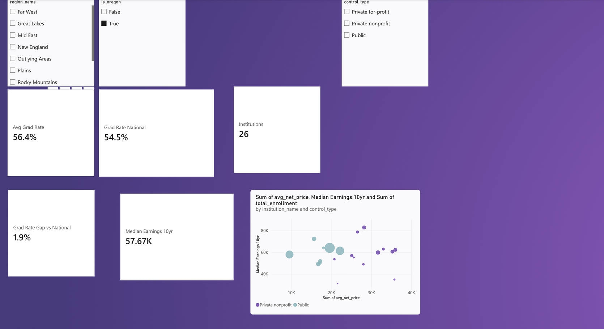

# Higher-Ed Outcomes Analytics (dbt + DuckDB + Power BI)

A small end-to-end analytics engineering project: integrate two public U.S. Department of
Education sources, model them into a tested star schema with dbt, and report on them in Power BI.

**Question answered:** how do Oregon institutions compare with peers on graduation, retention,
cost, earnings and enrollment?

> Personal project, built to practice analytics engineering. Data is public and real (not synthetic).

## Sources
| Source | Use |
|---|---|
| College Scorecard, institution-level (June 2026 release) | Outcomes, cost, earnings |
| IPEDS HD 2024 | Institution characteristics, location |
| IPEDS EF 2023 (fall enrollment) | Enrollment by student level |
| IPEDS GR 2023 (graduation rates) | Bachelor's cohort completion |

All join on `UNITID`.

## Architecture (medallion)
```
raw CSVs -> bronze (views, all text) -> silver (typed, one row per institution) -> gold (star schema) -> exports/*.csv -> Power BI
```
- **Bronze:** raw files read as text, nothing coerced.
- **Silver:** typing, cleaning of `NULL`/`PrivacySuppressed`, and long-to-wide collapse of IPEDS files to one row per institution.
- **Gold:** `fact_institution_outcomes` + `dim_institution`, `dim_control`, `dim_region`.

## Models
All four bronze models read a CSV with `read_csv(..., all_varchar = true)`, so every column stays text and the folder comes from `var('raw_dir')`.

### Bronze: raw copies
| Model | What it does |
|---|---|
| `brz_scorecard` | Loads the raw College Scorecard file untouched (6,273 rows, 3,308 columns) |
| `brz_ipeds_hd` | Loads the raw IPEDS institution directory untouched |
| `brz_ipeds_ef` | Loads the raw IPEDS enrollment file untouched (115,156 rows, many per institution) |
| `brz_ipeds_gr` | Loads the raw IPEDS graduation file untouched (51,368 rows, many per institution) |

### Silver: cleaned, one row per institution
| Model | What it does | Functions used |
|---|---|---|
| `stg_scorecard` | Keeps about 15 of 3,308 columns, renames them, converts text to numbers, turns `NULL`/`PrivacySuppressed` into true NULLs, and merges public and private net price into one column | `try_cast`, `trim`, `coalesce`, `ref` |
| `stg_ipeds_institution` | Cleans the directory: name, city, state, sector, level, coordinates | `try_cast`, `trim` |
| `stg_ipeds_enrollment` | Collapses many rows per institution to one, pivoting total, undergraduate, and graduate enrollment into columns; trims space-padded level codes | `trim`, `max(case when ...)`, `group by`, `try_cast` |
| `stg_ipeds_graduation` | Collapses many rows to one and computes the bachelor's graduation rate (completers within 150% / cohort) | `max(case when ...)`, `group by`, `nullif`, `try_cast` |

### Gold: star schema
| Model | What it does | Functions used |
|---|---|---|
| `dim_control` | Lookup: 1 = Public, 2 = Private nonprofit, 3 = Private for-profit | `values` list |
| `dim_region` | Lookup: region codes 0-9 with names | `values` list |
| `dim_institution` | One row per institution: name, city, state, control, region, degree level, `is_oregon` flag, coordinates. Scorecard is the spine; IPEDS adds city and location | `left join`, `case` |
| `fact_institution_outcomes` | One row per institution: admission, retention, graduation (both sources), net price, tuition, earnings, Pell share, enrollment | `left join` on `unitid` |

Each gold model has a post-hook (`copy ... to 'exports/<name>.csv'`) that writes it out as a CSV after it builds.

### Functions at a glance
| Function | Purpose in this project |
|---|---|
| `try_cast(x as type)` | Converts text to a number; returns NULL instead of erroring (turns `PrivacySuppressed` into NULL) |
| `trim()` | Removes stray spaces (`' 1'` becomes `'1'`) |
| `coalesce(a, b)` | Uses `a`, or `b` when `a` is NULL (public net price, else private) |
| `nullif(x, 0)` | Returns NULL when `x` is 0, avoiding divide-by-zero in the graduation rate |
| `max(case when ...)` + `group by` | Pivots several rows per institution into columns, one row per institution |
| `left join` | Keeps every row on the left and adds matches from the right |
| `ref('model')` | Declares a dependency, so dbt builds models in the right order |
| `var('raw_dir')` | Reads the raw-data folder from `dbt_project.yml` |

## Data quality
25 dbt data tests run on every build: uniqueness and not-null keys, relationships between fact and
dimensions, a custom 0-1 range test on rates, and a cross-source reconciliation (IPEDS-computed vs
Scorecard graduation rate: correlation 0.965, median gap 2.3 points across 1,713 institutions; the
31 institutions above a 15-point gap are small colleges with volatile cohorts and surface as a warning).

## Power BI semantic model
The gold CSVs in `exports/` load into Power BI as a star schema. Relationships (single direction, dimension filters fact):
`dim_institution[unitid]` to `fact_institution_outcomes[unitid]`, `dim_control[control_code]` to `dim_institution[control_code]`, `dim_region[region_code]` to `dim_institution[region_code]`.
The report page is filtered to bachelor's-predominant institutions, because the graduation-rate data only applies to four-year schools. Setup files are in `powerbi/` (`load_tables.m`, `measures.dax`, `QUICKSTART.md`).

### Dashboard


*Screenshot of the report built in Power BI (web) on the gold tables, with the Oregon-only slicer on and the page filtered to bachelor's-granting institutions. The cards show 26 institutions, a 56.4% average graduation rate against a 54.5% national baseline (a 1.9-point gap), and median earnings of $57,671; the scatter plots net price against median earnings, colored by control type. The semantic model was loaded from an Excel workbook of the exported tables (`powerbi/higher_ed_powerbi.xlsx`). An illustrative layout mockup is also available at `docs/dashboard_mockup.png`.*

### DAX measures
```dax
Institutions = DISTINCTCOUNT ( fact_institution_outcomes[unitid] )

Avg Grad Rate = AVERAGE ( fact_institution_outcomes[grad_rate_150_sc] )

Avg Retention = AVERAGE ( fact_institution_outcomes[retention_rate_ft] )

Avg Net Price = AVERAGE ( fact_institution_outcomes[avg_net_price] )

Median Earnings 10yr = MEDIAN ( fact_institution_outcomes[median_earnings_10yr] )

Grad Rate National =
CALCULATE (
    [Avg Grad Rate],
    ALL ( dim_institution ),
    dim_institution[predominant_degree] = "Bachelor's"
)

Grad Rate Gap vs National = [Avg Grad Rate] - [Grad Rate National]
```

| Measure | What it does |
|---|---|
| `Institutions` | Count of institutions in the current filter context |
| `Avg Grad Rate` | Unweighted average 150%-time graduation rate; institutions with no reported value are skipped |
| `Avg Retention`, `Avg Net Price` | Unweighted averages of first-year retention and average net price |
| `Median Earnings 10yr` | Median of institutions' median earnings ten years after enrollment |
| `Grad Rate National` | Baseline that ignores user filters: `ALL(dim_institution)` clears the state, region, and control filters, and the bachelor's filter is re-applied so the comparison is like-for-like |
| `Grad Rate Gap vs National` | Current selection minus the national baseline (for Oregon, about +1.9 points) |

Expected values with the bachelor's filter (checked against the exported data): Oregon has 26 institutions, a 56.4% average graduation rate against a 54.5% national baseline, and median earnings of $57,671 against $53,781.

## Run it
```bash
python -m venv .venv && source .venv/bin/activate   # Windows: .venv\Scripts\activate
pip install dbt-duckdb
# download the four source files into raw/ (see WALKTHROUGH.md for URLs)
mkdir exports
dbt build --profiles-dir .
dbt docs generate --profiles-dir . && dbt docs serve --profiles-dir .
```
Gold tables export to `exports/` for Power BI.

## Known limitations
- GRTYPE codes (2 = bachelor's cohort, 3 = completers in 150%) were inferred, then validated against Scorecard; no official codebook was used.
- Scorecard and IPEDS cover slightly different cohort years.
- No incremental models or slowly changing dimensions: the data is a single snapshot, so they would not be meaningful.
